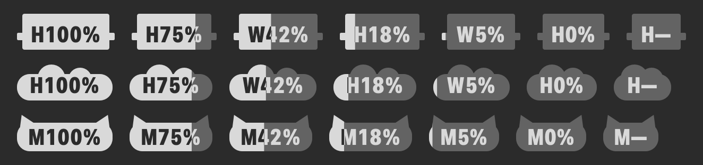
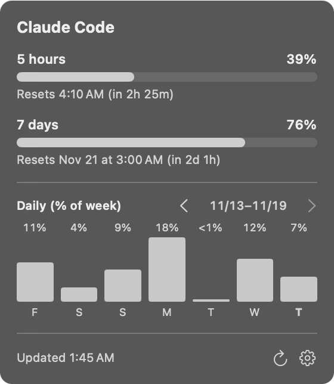
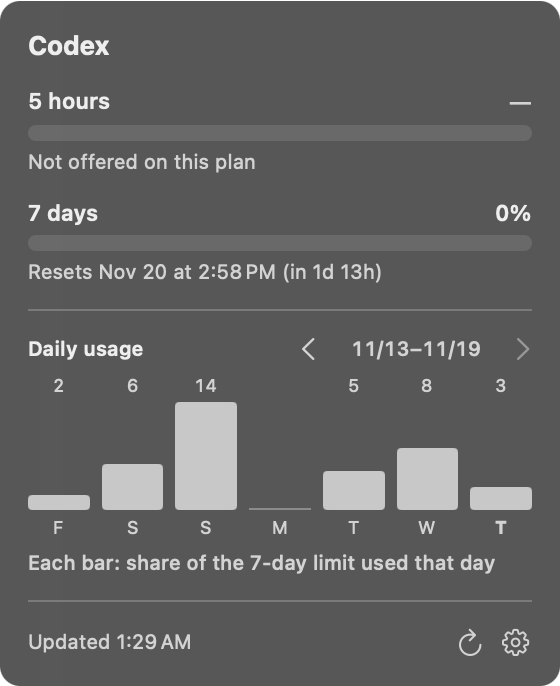
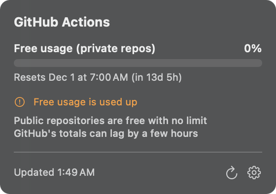
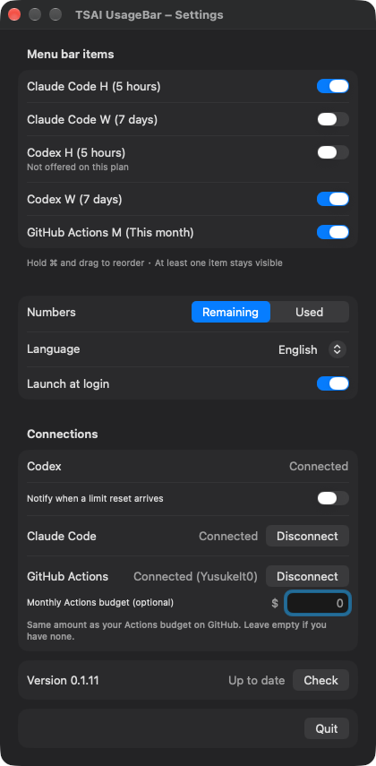

#  TSAI UsageBar

A lightweight macOS menu bar app that shows how much of your **Claude Code** and **Codex** usage limits is left and when they reset, plus your **GitHub Actions** free usage for private repositories.

<p>
  <br>
  
</p>

<p>
  
  
  
</p>

<sub>In these screenshots the Claude Code and Codex daily bars and the $10 GitHub budget are sample values; all other numbers are real.</sub>

> **Unofficial.** Not affiliated with, endorsed by, or sponsored by Anthropic, OpenAI or GitHub. Claude and Claude Code are trademarks of Anthropic, PBC. Codex and OpenAI are trademarks of OpenAI. GitHub and the Octocat are trademarks of GitHub, Inc. The icons are simplified silhouettes used only to tell the services apart.

## What it shows

| Item | Meaning |
|---|---|
| `H42%` | 5-hour limit (Claude Code, Codex) |
| `W68%` | 7-day limit (Claude Code, Codex) |
| `M42%` | This month's free GitHub Actions usage for private repositories |
| `H—` | No current value (never received, or for Codex and GitHub, the reset time passed and no new value has arrived yet) |

- Numbers show **remaining** by default (100 − used). Switch to **used** in Settings.
- Each icon fills like a battery: the solid part matches the number shown, and the rest is faint. With no value, the whole icon is faint.
- Up to five items: Claude Code H/W, Codex H/W and GitHub Actions M. Turn each on or off in Settings; hold ⌘ and drag to reorder. Turning off all of a service's items pauses it.
- Click an item to see that service's bars, reset times (in your Mac's time zone) and time remaining.
- **Daily usage**: below the windows, a chart shows the last 7 days, one bar per day; ◀ ▶ step through earlier weeks.
  - Claude Code and Codex: the share of the 7-day limit used each day. These services report only current percentages, so the app records the daily increase locally, starting when you install this version (about 120 days are kept). Days before that show as empty outlines.
  - GitHub Actions: the share of the monthly allowance that private repositories used each day, from GitHub's official per-day billing data, so earlier days are available too (UTC dates).
- Codex **limit resets** (reset credits): when you have any, the Codex panel shows how many are left and the earliest expiry. Optionally, a macOS notification tells you when a new one arrives (Settings → **Notify when a limit reset arrives**, off by default). Claude Code's data doesn't include this, so it's Codex only.
- Windows your plan doesn't have (for example, plans without a 5-hour limit) are hidden automatically.
- Values aren't guessed. After a reset time, Codex and GitHub show `—` until their next official value. Claude Code drops a window from its data once it resets and starts a new one with your next use, so its window shows full (100% remaining) until then.
- Languages: English, 日本語, 繁體中文, 简体中文, 한국어, Français, Deutsch, ไทย, Português (Brasil), Bahasa Indonesia, Español and Русский. Automatic picks the first supported macOS language (otherwise English; any Portuguese uses Brazilian Portuguese), or choose one in Settings.



## Install

Requires macOS 14 or later (Apple silicon or Intel). No sudo, Homebrew, or SwiftBar.

```sh
curl -fsSL https://raw.githubusercontent.com/YusukeIt0/tsai-usage-bar/main/install.sh | sh
```

The installer picks your CPU's build from the latest GitHub Release, checks its SHA-256 checksum and code signature, installs it to `~/Applications`, and starts it.

> Builds are currently **not notarized by Apple** (no Developer ID signing yet). The checksum and signature checks above confirm the download is intact.

**Updates:** about once a day the app checks this repository's releases. When a newer version exists, the panel and Settings show **Update**, which installs it and keeps your settings. Settings → **Check** checks right away.

**Uninstall** (also restores your Claude Code status line):

```sh
curl -fsSL https://raw.githubusercontent.com/YusukeIt0/tsai-usage-bar/main/install.sh | sh -s -- --uninstall
```

## Connect

**Codex** works automatically if you've signed in to the Codex CLI. If not, the app offers **Sign in to Codex in browser**, the official Codex sign-in. Limit-reset credits come from the same official read (`rateLimitResetCredits`); their expiry details are read only while a panel is open. Turning on reset notifications asks macOS for notification permission once; it is kept across updates.

**Claude Code** sends usage limits to its official `statusLine` command. Open Settings → **Connect**. After you confirm, the app:

1. backs up `~/.claude/settings.json`,
2. points `statusLine` at a small relay that saves only the limit percentages and reset times,
3. keeps running your previous status line command, so your status line looks the same.

**Disconnect** or uninstall puts the previous setting back. Values update with each Claude Code response. If you aren't signed in to Claude Code, the app offers **Sign in to Claude Code in browser** (`claude auth login`).

**GitHub Actions**: Settings → **Connect GitHub**. The app copies a one-time code and opens GitHub; paste it and authorize the *TSAI UsageBar* GitHub App. It can only read your plan and billing usage ("Plan: read").

- Standard runners on public repositories are free with no limit, so `M` shows the monthly included usage that private repositories consume (Free: 12 USD, Pro: 18 USD of compute; other plans show "—").
- It resets at 00:00 UTC on the 1st. GitHub's totals can lag by a few hours.
- **Budget (optional):** if you set an Actions budget on GitHub, enter the same amount under **Monthly Actions budget** in Settings (GitHub has no public API for personal budgets). `M` then measures against the free usage plus the budget, which is how much is left before Actions stops. In the panel, that bar is split by colour, blue for free usage and orange for budget, so you can see the mix without reading numbers. Below it, the budget on its own (remaining or used, orange) and the amount spent against it this month, which is GitHub's own billed figure.
- **Disconnect** forgets the token on this Mac; revoke the authorization anytime under GitHub → Settings → Applications.

## How it gets data

| | Source | When |
|---|---|---|
| Codex | Official `codex app-server`: `account/rateLimits/read` (`usedPercent`, `windowDurationMins`, `resetsAt`; reset credits from `rateLimitResetCredits`) | About every 3 minutes, every minute while its panel is open, right after a reset time, on wake and network recovery, and on ↻ |
| Claude Code | Official `statusLine` JSON: `rate_limits.five_hour` / `seven_day` (`used_percentage`, `resets_at`) | Immediately whenever Claude Code updates its status line |
| GitHub Actions | Official billing usage summary (`/users/{user}/settings/billing/usage/summary`, Actions) minus each public repository's usage; plan from `/user` | About hourly, when its panel opens (if older than 10 minutes), after wake, and on ↻. Daily chart: per-day summaries for the shown week only, when the panel shows it |

- Codex windows are matched by duration (300 min = H, 10080 min = W). Other buckets or durations are never substituted.
- Each Codex query starts `codex app-server`, reads, and stops it. Only read requests are sent: no sessions, model runs, purchases, or reset-credit use.
- Overlapping requests are merged and failures back off. Nothing is polled during sleep.
- Idle: about 30 MB memory and ~0% CPU on an Apple silicon Mac (0.1.12). The status line relay adds about 6 ms.

## Privacy

- No servers of its own and no analytics. The app's own network requests are the daily update check against this repository's releases and, only if you connect GitHub, read-only GitHub API requests (your plan, public repository list and Actions usage). Codex and Claude Code talk to their own services.
- Stored locally in `~/Library/Application Support/TSAI UsageBar/`: limit percentages and reset times, the daily usage history, and, if you connect GitHub, its access token in a file readable only by your user (like the Codex CLI's login file). The Keychain isn't used because ad-hoc signed updates would make macOS ask for access again each time. Preferences are in the app's defaults.
- Never stored or logged: Codex or Claude Code credentials, prompts, conversations, transcript paths, or session IDs. The app doesn't read the Keychain or call private endpoints.

## Build from source

```sh
swift test                   # unit tests
scripts/build-app.sh         # dist/TSAI UsageBar.app + per-arch zips + SHA256SUMS
scripts/release.sh           # tag and publish a GitHub Release (maintainers)
swift scripts/make-icon.swift # regenerate the app icon from Resources/icon/surf-rabbit.png
```

Swift 5.10+ / Xcode 16+. Set `SIGN_IDENTITY` to a Developer ID Application identity to sign; otherwise builds are ad-hoc signed.

## License

MIT
