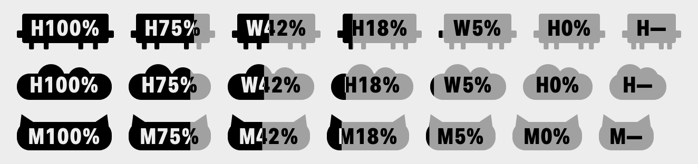

# TSAI UsageBar

A lightweight macOS menu bar app that shows how much of your **Claude Code** and **Codex** usage limits is left, and when they reset.

CodexとClaude Codeの利用枠の残量・リセット時刻を、メニューバーから確認できる軽量なmacOSアプリです。（[日本語](#日本語)）

<p>
  <br>
  
</p>

> **Unofficial.** Not affiliated with, endorsed by, or sponsored by Anthropic or OpenAI. Claude and Claude Code are trademarks of Anthropic, PBC. Codex and OpenAI are trademarks of OpenAI. The icons are simplified silhouettes used only to tell the two providers apart.

## What it shows

| Item | Meaning |
|---|---|
| `H42%` | 5-hour limit |
| `W68%` | 7-day limit |
| `H—` | No current value (never received, or the reset time passed and no new value has arrived yet) |

- Each icon fills like a battery: the solid part matches the number shown (remaining by default, or used), and the rest is faint. With no value the whole icon is faint.
- Up to four items: Claude Code H/W and Codex H/W. Turn each on or off in Settings; hold ⌘ and drag to reorder.
- Numbers show **remaining** by default (100 − used). Switch to **used** in Settings.
- Click an item for that provider's two windows, bars, and reset times in your Mac's time zone.
- Turning off both items of a provider pauses it: no Codex queries, and nothing stored from Claude Code.
- Windows your plan doesn't have (for example, plans without a 5-hour limit) are hidden automatically.
- Values are never guessed. Reaching a reset time doesn't turn a value into 100%; the app waits for the next official value.

## Install

Requires macOS 14 or later (Apple silicon or Intel). No sudo, Homebrew, or SwiftBar.

```sh
curl -fsSL https://raw.githubusercontent.com/YusukeIt0/tsai-usage-bar/main/install.sh | sh
```

The installer picks your CPU's build from the latest GitHub Release, checks its SHA-256 checksum and code signature, installs it to `~/Applications`, and starts it. Run the same command to update; settings are kept.

> Builds are currently **not notarized by Apple** (no Developer ID signing yet). The checksum and signature checks above confirm the download is intact.

Uninstall (also restores your Claude Code status line):

```sh
curl -fsSL https://raw.githubusercontent.com/YusukeIt0/tsai-usage-bar/main/install.sh | sh -s -- --uninstall
```

## Connect

**Codex** works automatically if you've signed in to the Codex CLI. If not, the app shows **Sign in to Codex in browser**, which starts the official Codex sign-in.

**Claude Code** sends usage limits to its official `statusLine` command. Open Settings → **Connect**. After you confirm, the app:

1. backs up `~/.claude/settings.json`,
2. points `statusLine` at a small relay that saves only the limit percentages and reset times,
3. keeps running your previous status line command, so your status line looks the same.

**Disconnect** or uninstall puts the previous setting back. Values update with each Claude Code response. If you aren't signed in to Claude Code, the app offers **Sign in to Claude Code in browser** (`claude auth login`).

## How it gets data

| | Source | When |
|---|---|---|
| Codex | Official `codex app-server`: `account/rateLimits/read` (`usedPercent`, `windowDurationMins`, `resetsAt`) | About every 3 minutes, every minute while its popover is open, right after a reset time, on wake and network recovery, and on Refresh |
| Claude Code | Official `statusLine` JSON: `rate_limits.five_hour` / `seven_day` (`used_percentage`, `resets_at`) | Immediately whenever Claude Code updates its status line |

- Codex windows are matched by duration (300 min = H, 10080 min = W). Other buckets or durations are never substituted.
- Each Codex query starts `codex app-server`, reads, and stops it. Only read requests are sent: no sessions, model runs, purchases, or reset-credit use.
- Overlapping requests are merged; failures back off up to 30 minutes. Nothing is polled during sleep.
- Idle: about 17 MB memory and ~0% CPU on an Apple silicon Mac. The status line relay adds about 6 ms.

## Privacy

- No servers or analytics. Its only network call is an update check against this repository's GitHub Releases about once a day, with a generic `TSAI-UsageBar/<version>` User-Agent. Codex and Claude Code talk to their own services.
- When a newer version exists, the popover and Settings show **Update**, which runs the installer from that release's tag (settings are kept).
- Stored locally: limit percentages and reset times in `~/Library/Application Support/TSAI UsageBar/`, and your preferences.
- Never stored or logged: tokens, credentials, prompts, conversations, transcript paths, or session IDs.
- Credentials stay with the Codex CLI and Claude Code. The app doesn't read the Keychain or call private endpoints.

## Build from source

```sh
swift test                   # unit tests
scripts/build-app.sh         # dist/TSAI UsageBar.app + per-arch zips + SHA256SUMS
scripts/release.sh           # tag and publish a GitHub Release (maintainers)
```

Swift 5.10+ / Xcode 16+. Set `SIGN_IDENTITY` to a Developer ID Application identity to sign; otherwise builds are ad-hoc signed.

---

## 日本語

- **表示:** `H` は5時間、`W` は7日間の利用枠。初期設定は残量（100 − 使用率）で、設定から使用率に切り替えられます。値がない、またはリセット後に新しい値がまだ届いていないときは `H—` と表示します。
- **アイコン:** バッテリーのように、表示中の数値（残量または使用率）の分だけ濃く塗られ、残りは薄く表示されます。値がないときは全体が薄くなります。
- **項目:** Claude Code・Codex のH/W最大4つ。設定で個別にON/OFF、⌘ドラッグで並べ替え。プランにない枠（5時間制限がないプラン等）は自動で非表示になります。あるサービスの項目を両方OFFにすると、そのサービスの取得を止めます。
- **クリック:** そのサービスの5時間・7日間の棒グラフと、Macのタイムゾーンでのリセット時刻を表示します。
- **インストール・更新:** 上記の `curl … | sh`（sudo不要、`~/Applications` に導入、設定は保持）。現在のビルドはApple公証前です。
- **Codex:** Codex CLIにサインイン済みならそのまま使えます。未サインインなら「ブラウザでCodexにサインイン」から公式の手順でサインインできます。
- **Claude Code:** 設定の「連携する」から。`~/.claude/settings.json` をバックアップし、既存のstatusLine表示を保ったまま中継します。「連携を解除」やアンインストールで元に戻ります。
- **アップデート:** 1日1回GitHub Releasesを確認し、新しい版があればポップアップと設定に「アップデート」ボタンが出ます（設定は保持）。
- **プライバシー:** 独自サーバー・分析なし。通信は上記の更新確認だけです。保存するのは利用率・リセット時刻と設定だけです。

## License

MIT
